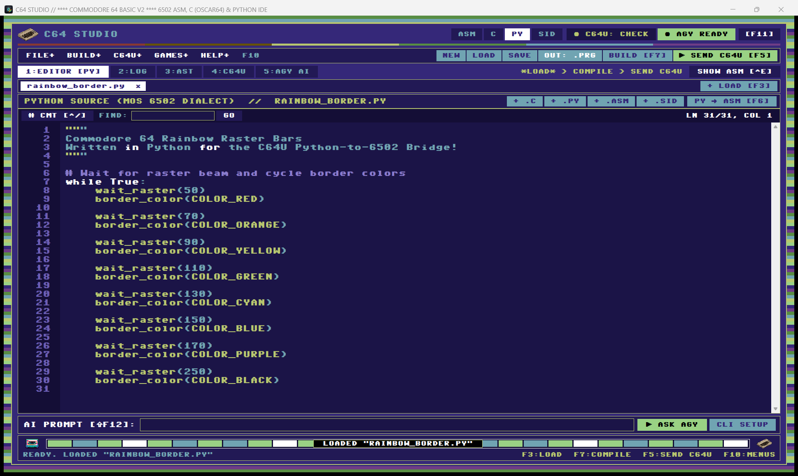
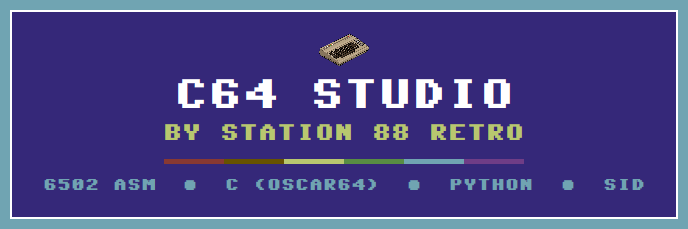
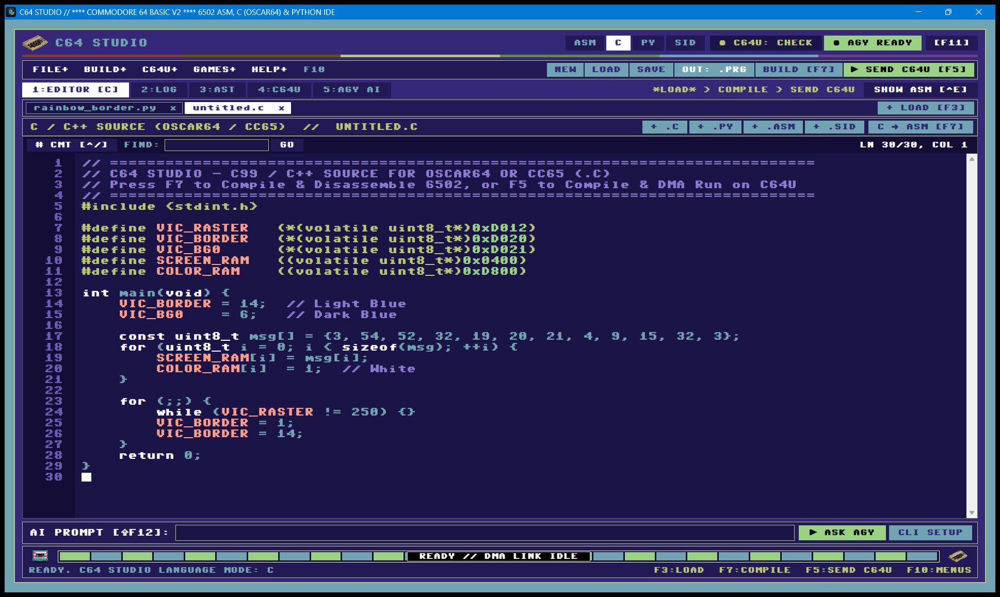
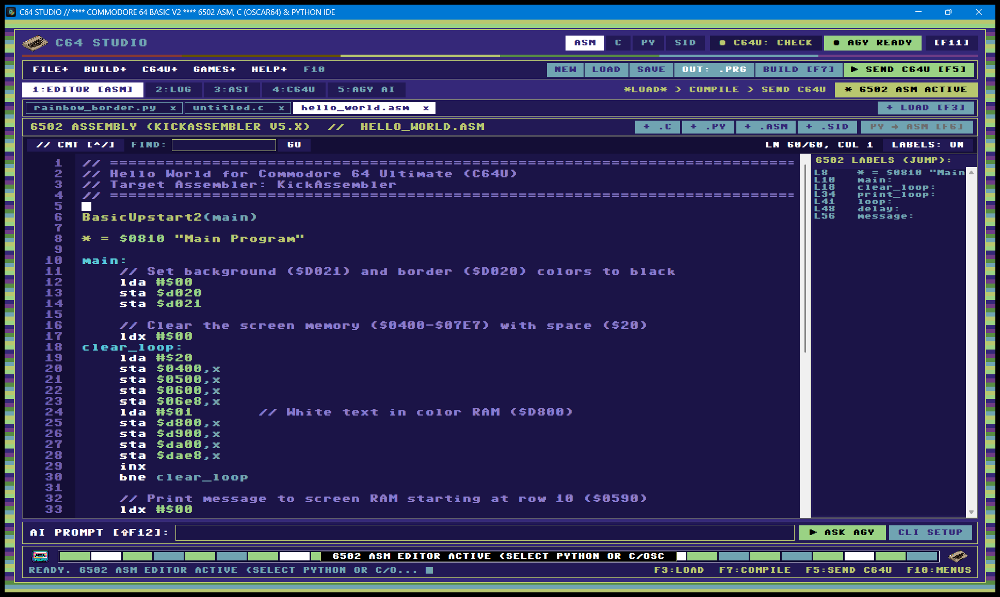
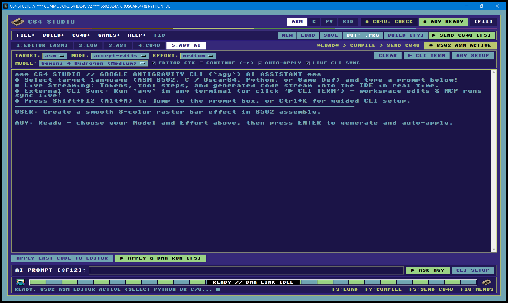
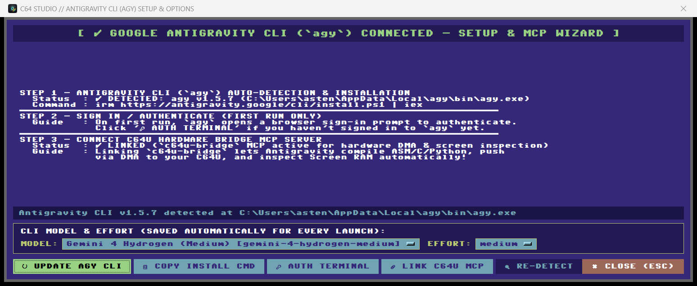
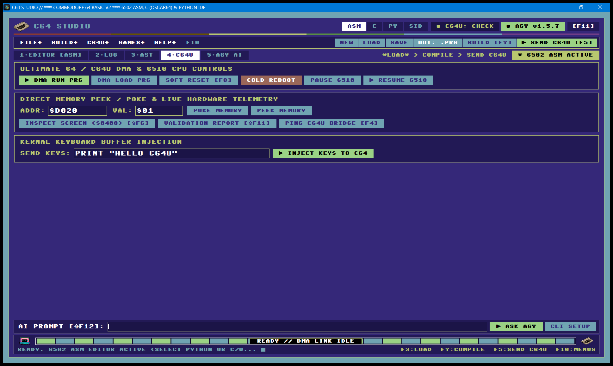

# C64 Studio & C64U Antigravity Bridge

[](LICENSE)
[](https://www.python.org/)
[](https://modelcontextprotocol.io/)
[](https://antigravity.google/)
[](https://1541u-documentation.readthedocs.io/)

An authentic **Commodore 64 Lookalike Multi-Language IDE (`C64 Studio`)**, complete 8-bit **Game Development Suite**, and **MCP Hardware Bridge** connecting **[Google Antigravity](https://antigravity.google/docs/mcp)** (`agy` CLI & AI agents) directly to physical **Commodore 64 Ultimate (C64U)** and **Ultimate 64** hardware over DMA.

> **Code in 6502 Assembly, C (Oscar64), or Python — or prompt Google Antigravity CLI directly inside a Commodore 64 CRT screen — and deploy via sub-second DMA to real C64 silicon.**



---

## 🆕 Latest Changes & Release Highlights

* **🖥️ Unified `C64 Studio` Multi-Language IDE (`c64-studio` / `C64-Studio.bat`)**:
  * Upgraded and renamed the legacy TUI into **C64 Studio** (`src/c64u_bridge/c64_studio.py`, with `tui.py` preserved as a backwards-compatible shim) and made it the single default development hub (retiring redundant standalone interactive CLI subcommands and removing legacy ZX Spectrum themes for a pure Commodore 64 aesthetic).
  * Authentic `LOAD "C64-BRIDGE",8,1` startup animation with animated VIC-II fast-loader raster bars, a configurable end-of-boot pause, and the embedded **Pet Me 64** (`PetMe64.ttf`) bitmap font.
* **🤖 Built-in Google Antigravity CLI (`agy`) Integration**:
  * **Live AI Prompt Bar (`Shift+F12` / `Alt+A`) & AI Console (`5:AGY AI`)**: Prompt Antigravity directly from inside C64 Studio; responses stream live into the CRT console and generated `.asm`, `.c`, or `.py` code blocks auto-apply straight into the active editor for 1-key DMA execution (`F5`).
  * **Auto-Detection & Guided Setup Walkthrough (`Ctrl+K`)**: Automatically detects `agy` on startup. If missing, walks you through setup with a copyable official install command **or 1-click Auto-Download & Install**, first-run browser authentication helper, and **1-click `c64u-bridge` MCP server linking** (`agy mcp add`).
* **🔤 Three Native C64 Languages in One IDE**:
  1. **6502 Assembly (`.asm` / `.s`)** — **KickAssembler v5.x** & **ACME** with real-time syntax highlighting, subroutine/label navigator, smart auto-indent, Full 6502 ASM Focus Mode (`Ctrl+E`), and automatic **KickAssembler upstream version check & 1-click updater**.
  2. **C / C++ (`.c` / `.cpp`)** — First-class **[Oscar64](https://github.com/drmortalwombat/oscar64)** & **CC65** optimizing 6502 compiler workflow (`C source → optimized 6502 machine code → DMA → C64U`), complete with C/hardware-register syntax highlighting, starter templates (`+ .C`), and post-compile 6502 disassembly inspection.
  3. **Python (`.py`)** — Built-in **Python-to-6502 AST Transpiler** converting bare-metal Python intrinsics (`wait_raster`, `border_color`, `poke`, `peek`, `sid_tone`, `print_str`, `clear_screen`) into commented KickAssembler 6502 assembly (`+ .PY`).
* **📋 Automated Deployment Validation Reports (`Shift+F11` & MCP `c64_validation_report`)**:
  * Every DMA deployment automatically records compilation status, `.prg` size, C64U connection & firmware version, live 40×25 Screen RAM (`$0400`) snapshot, VIC-II/SID/Zero-Page register telemetry, and a **structural diff against the previous deployment** for rapid AI and hardware debugging.
* **🎮 Integrated `40 GAME DEV` Toolchain, `HYPERLOAD` Fast Tape (`F12`), & Cycle-Exact Simulator**:
  * **Unified Sequence (`LOAD [F3] > BUILD [F7] > RUN [F5]`)**: Load any source, game asset definition, or binary image, build with `F7`, and DMA-run with `F5` or master to `.tap` (`Shift+F2`), **HYPERLOAD** turbo `.tap` with VIC-II border stripes (`F12`), or 1541 `.d64` disk (`Shift+F9`).
  * **Asset Builders & Simulators (`Alt+G`)**: Scaffold full multi-step `build.py` game projects, Sprite Banks, Multicolor Tilesets + Maps, Koala Title Screens, 3-Voice SID Tracker Songs, Level Tables, **C64 Screen Simulator (`c64sim`)**, and **6502/SID Cycle Profiler (`sim6502`)**.
* **🔍 Multi-Stage D64 / TAP / PRG / SID Reverse Decompiler**:
  * Disassembles `.d64` disks, `.tap` cassettes, `.prg` binaries, and `.sid` music into richly commented KickAssembler v5.x 6502 assembly (explaining `$D000` VIC-II, `$D400` SID, `$DC00/$DD00` CIA, and KERNAL calls) and prompts whether to decompile the **Loader**, the **Main Game**, or **Both**.

---

## 📸 C64 Studio Gallery

| Station 88 Retro Splash Screen | C / Oscar64 Optimizing Compiler Mode |
| :---: | :---: |
|  |  |
| **Full 6502 Assembly IDE (`Ctrl+E`)** | **Antigravity CLI (`agy`) AI Console (`Shift+F12`)** |
|  |  |
| **Antigravity CLI Setup & MCP Wizard (`Ctrl+K`)** | **C64U Hardware DMA & 6510 CPU Console** |
|  |  |

---

## 🔄 Closed-Loop AI + Hardware Architecture

```text
┌──────────────────────────┐    agy CLI / MCP    ┌─────────────────────────────┐
│ Google Antigravity (agy) │ ──────────────────▶ │ C64 Studio & C64U Bridge    │
│ Prompt Bar / IDE / Agent │ ◀────────────────── │ • KickAss / ACME (6502 ASM) │
└──────────────────────────┘  Validation Report  │ • Oscar64 / CC65 (C / C++)  │
                              + Screen/RAM Diff  │ • Python-to-6502 Transpiler │
                                                 │ • Game Dev Suite + Sim6502  │
                                                 └──────────────┬──────────────┘
                                                                │ High-Speed DMA (HTTP Port 80)
                                                                ▼
                                                 ┌─────────────────────────────┐
                                                 │ Physical C64 Ultimate (C64U)│
                                                 │ MOS 6510 • VIC-II • SID     │
                                                 └─────────────────────────────┘
```

---

## 🚀 Quick Start

### 1. Automated Setup
```powershell
# Windows PowerShell / CMD
.\setup.ps1
# or cross-platform Python wizard:
python setup_bridge.py
```

### 2. Launch **C64 Studio**
**Windows One-Click Launcher (Windowless):**
```bat
C64-Studio.bat
```

**From Terminal / Virtual Environment:**
```bash
# Launch C64 Studio (with authentic C64 boot sequence)
c64-studio

# Or skip the simulated LOAD "C64-BRIDGE",8,1 startup animation:
c64-studio --no-boot

# Open a specific .asm, .c, .py, build.py, .sid, .prg, .tap, or .d64 file on startup:
c64-studio game_dev/Heliscape/heliscape.asm
```

*(Headless Model Context Protocol stdio mode for Google Antigravity agents runs via `c64u-mcp` or `c64u-bridge mcp`.)*

---

## 🧭 The Studio Sequence & Keyboard Shortcuts

Every project in **C64 Studio** follows a clean three-step hardware workflow:
1. **Load (`F3`)** — Open any `.asm`, `.c`, `.py`, `build.py`, game asset definition, `.sid`, `.prg`, `.tap`, or `.d64` (or click `ASM` / `C/OSCAR` / `PYTHON` to start from a clean template).
2. **Build (`F7`)** — Automatically saves and builds according to file type: assembles `.asm` (or its full `build.py` project), compiles `.c`/`.cpp` with **Oscar64/CC65**, transpiles & assembles `.py`, or builds game assets.
3. **Run (`F5`) or Export** — Pushes via DMA to C64U with an **Automated Deployment Validation Report**, or exports to `.tap` (`Shift+F2`), **HYPERLOAD** fast-loader `.tap` (`F12`), or 1541 `.d64` (`Shift+F9`).

| Shortcut | Action |
| :--- | :--- |
| **`F1`** | Reference Guide & Full Font/Toolchain Credits |
| **`F2`** | Built-in C64 Code Presets (Rainbow Border, Screen Matrix, Hello World, SID Chime) |
| **`F3`** | Project File & Disk Browser (`LOAD "$",8`) |
| **`F4`** | Ping / Verify C64U Network Connection |
| **`F5`** | **Build + DMA Run on C64U** (logs Post-Deployment Validation Report & Diff) |
| **`F6`** | Transpile Python → 6502 Assembly |
| **`F7`** | **Build** (KickAssembler / Oscar64 / `build.py` / Asset Tool / SID Compiler) |
| **`F8`** | Soft Reset C64U Machine |
| **`F10` / `Alt+F/B/C/G/H`** | Focus On-Screen 5-Column Menu Deck (Navigate with Arrow Keys) |
| **`F11`** | Toggle Borderless Fullscreen C64 Monitor Mode |
| **`F12`** | Master `.tap` Cassette with **HYPERLOAD** Fast Loader & Border Stripes |
| **`Shift+F1` / `Ctrl+S`** | Save Loaded Source File |
| **`Shift+F2`** | Master & Export Standard `.tap` Cassette Image |
| **`Shift+F3`** | DMA Load `.prg` into C64 RAM without executing |
| **`Shift+F4` / `Shift+F5`** | Pause / Resume MOS 6510 CPU |
| **`Shift+F6`** | Inspect Live C64 Screen (`$0400` Screen RAM & `$D800` Color RAM) |
| **`Shift+F7`** | Cold Reboot C64U |
| **`Shift+F8` / `Ctrl+Q`** | Quit C64 Studio |
| **`Shift+F9`** | Compile & Package 35-Track 1541 `.d64` Floppy Disk Image |
| **`Shift+F10`** | Launch HTML5 **VIC-II Retro Sprite Studio** in Browser |
| **`Shift+F11`** | Capture & View **Automated Deployment Validation Report** |
| **`Shift+F12` / `Alt+A`** | Focus **Google Antigravity CLI (`agy`) Prompt Bar** & `5:AGY AI` Console |
| **`Ctrl+K`** | Open **Antigravity CLI (`agy`) Auto-Detect, Installer & MCP Wizard** |
| **`Ctrl+E`** | Toggle Full 6502 ASM IDE Focus Mode vs Split View |
| **`Ctrl+N`** | New 6502 KickAssembler `.asm` Starter Template |
| **`Ctrl+P`** | Upload & Play `.sid` on C64U Hardware SID Player |

---

## 🚁 Featured Showcases: *Heliscape* & *Ironfront*

* **[`game_dev/Heliscape/`](game_dev/Heliscape/)**: Complete side-scrolling tactical helicopter rescue game across 255 levels featuring four-band raster parallax scrolling over a 2048-pixel world, mid-screen hardware sprite zone multiplexing, a 48-pixel Airwolf-style gunship, tank/jet/flak/gunship AI, destructible POW camps, and 3-voice SID tracker music. Build with `F7` in C64 Studio or `python tools/build/build_tool.py game_dev/Heliscape/build.py`.
* **[`game_dev/ironfront/`](game_dev/ironfront/)**: Real-time C64 tactical strategy showcase built with the studio's sprite, Koala loading screen, tileset, and SID tracker pipelines.

---

## 🤖 Configuring MCP with Google Antigravity

Click **🔗 LINK C64U MCP** inside C64 Studio's **Antigravity CLI Setup Wizard (`Ctrl+K`)** for 1-click registration, or add `c64u-bridge` to your MCP config:

```json
{
  "mcpServers": {
    "c64u-bridge": {
      "command": "uv",
      "args": ["run", "--directory", "/absolute/path/to/c64u-antigravity-bridge", "c64u-bridge", "mcp"],
      "env": {
        "C64U_HOST": "192.168.1.64",
        "KICKASS_JAR": "tools/kickassembler/KickAss.jar"
      }
    }
  }
}
```

| MCP Tool | Description |
| :--- | :--- |
| `c64_build_and_run` | Compiles `.asm` (KickAss/ACME), `.c`/`.cpp` (Oscar64/CC65), or `.py`, DMA-runs on C64U, and appends an automated validation report + diff. |
| `c64_run_binary` | DMA uploads and executes an existing `.prg` binary with post-deployment validation. |
| `c64_validation_report` | Retrieves the latest post-deployment validation report and memory/screen diff. |
| `c64_inspect_screen` | Reads `$0400–$07E7` Screen RAM and `$D800–$DBE7` Color RAM into a 40×25 PETSCII/ANSI grid. |
| `c64_read_memory` / `c64_write_memory` | Non-invasively reads or DMA-writes C64 RAM, Zero Page, VIC-II, or SID registers. |
| `c64_play_sid` / `c64_compile_sid` | Plays PSID/RSID tunes on C64U hardware or recompiles decompiled SID sources. |
| `c64_control` / `c64_send_keys` / `c64_status` | Machine reset/reboot/pause/resume, keyboard buffer injection, and firmware status. |

---

## 📁 Repository Structure

```text
c64u-antigravity-bridge/
├── .agents/skills/c64-development/ # Authoritative C64 engineering master skill (VIC-II, SID, 6502)
├── curated_core_docs/              # Primary C64 Programmer's Reference, VIC-II, SID, CIA & 1541 docs
├── game_dev/
│   ├── Heliscape/                  # 255-level parallax helicopter rescue game
│   └── ironfront/                  # Real-time C64 strategy game
├── tools/                          # Build manifest runner, Hyperload tape, c64sim, sim6502 & asset tools
├── screenshots/C64_Studio/         # Full-HD 1080p screenshots of C64 Studio
├── src/c64u_bridge/
│   ├── c64_studio.py               # C64 Studio Multi-Language IDE, Game Dev Deck & Antigravity AI Console
│   ├── agy_cli.py                  # Antigravity CLI (`agy`) auto-detector, installer, MCP linker & runner
│   ├── compiler.py                 # KickAssembler (w/ auto-updater), Oscar64, ACME & CC65 orchestrator
│   ├── validation_report.py        # Post-deployment hardware telemetry & cross-deploy diff engine
│   ├── project.py / gamedev.py     # Game project scaffolding, file classification & tool runner
│   ├── prg_decompiler.py           # Multi-pass 6502 disassembler & Loader/Main stage analyzer
│   ├── d64.py / tap.py             # 1541 .d64 disk & .tap cassette reader/mastering engines
│   ├── sid_decompiler.py / sid_compiler.py # PSID/RSID round-trip disassembler & builder
│   ├── transpiler.py               # Python AST-to-6502 compiler
│   ├── client.py / server.py       # C64U REST/DMA client & JSON-RPC 2.0 MCP server
│   ├── tui.py                      # Backwards-compatible shim re-exporting C64 Studio
│   └── cli.py                      # Hub launcher (`c64-studio` / `c64u` / `mcp`)
├── C64-Studio.bat                  # Windows windowless launcher for C64 Studio
└── tests/                          # Automated pytest suite (116 tests)
```

---

## 🙏 Credits & Attribution

* **Commodore 64 Bitmap Font (`PetMe64.ttf`)**: Created by **Kreative Korporation / Kreative Software** (Rebecca G. Bettencourt) — <https://www.kreativekorp.com/software/fonts/c64/> — distributed under the **Kreative Software Relay Fonts Free Use License v1.2f** ([`LICENSE-Kreative-FreeUse-1.2f.txt`](src/c64u_bridge/assets/fonts/LICENSE-Kreative-FreeUse-1.2f.txt)), sourced via **[Faerie](https://github.com/KiwiGeek/Faerie)** and shared with **BackMeUpScotty**.
* **Hardware & Compiler Ecosystem**: **Gideon Zweijtzer** (Ultimate-II+ / Ultimate 64 / C64U), **Mads Nielsen** (KickAssembler), **DrMortalWombat** (Oscar64 C/C++ Compiler), **Marco Baye** (ACME), and the **CC65** team.

---

## 📜 License

Distributed under the MIT License. See [`LICENSE`](LICENSE) for details.
